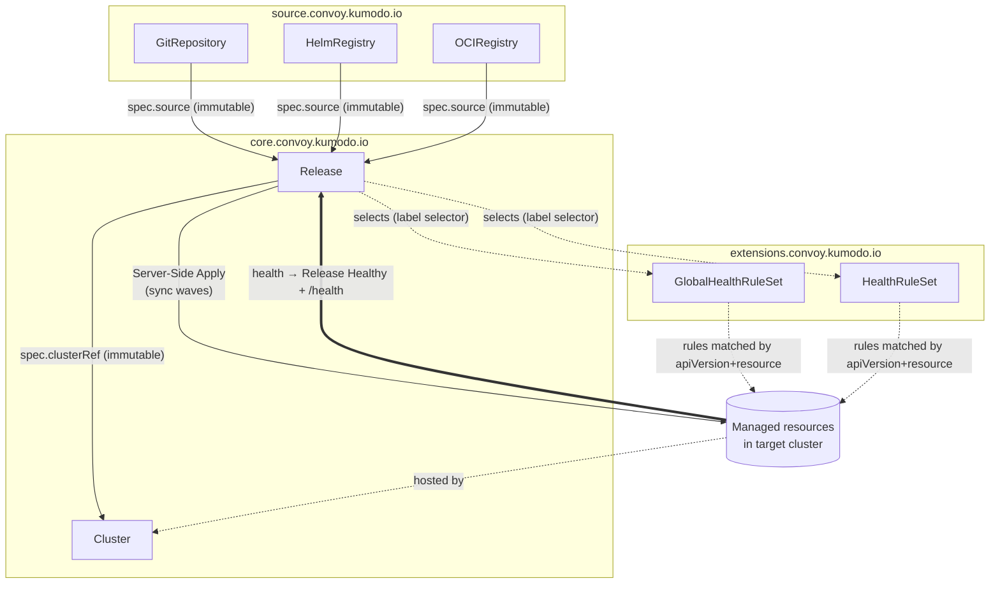

<!-- TOC -->
  * [API Groups and Versions](#api-groups-and-versions)
  * [Types at a Glance](#types-at-a-glance)
  * [How the Types Relate](#how-the-types-relate)
  * [Deployment Flow](#deployment-flow)
  * [Reference Fields](#reference-fields)
  * [External References](#external-references)
  * [Type Documents](#type-documents)
<!-- TOC -->

convoy's API is served by a Kubernetes **aggregated API server**. Every kind is a first-class API object — created, read, and RBAC-controlled like any built-in resource — and several carry behavior-specific **subresources** (e.g. `/sync`, `/preview`, `/health`). All kinds are currently at version `v1alpha1`.

This document gives the shape of the API and how the types fit together. Each kind has its own reference doc (see [Type Documents](#type-documents)).

## API Groups and Versions

| API group                       | Kinds                                          | Purpose                                                        |
|---------------------------------|------------------------------------------------|----------------------------------------------------------------|
| `core.convoy.kumodo.io`         | `Release`, `Cluster`                           | The deployment unit and the target clusters it deploys to.     |
| `source.convoy.kumodo.io`       | `GitRepository`, `HelmRegistry`, `OCIRegistry` | Content sources the deployment pipeline pulls from.            |
| `extensions.convoy.kumodo.io`   | `GlobalHealthRuleSet`, `HealthRuleSet`         | Custom (CEL) rules extending how resource health is assessed.  |

## Types at a Glance

| Kind                 | Group        | Scope          | Summary                                                                                                                                    |
|----------------------|--------------|----------------|--------------------------------------------------------------------------------------------------------------------------------------------|
| `Release`            | `core`       | Namespaced     | The deployment unit. Binds one `Source` + one `Cluster` + a content interpretation, with an ordered mutation pipeline and lifecycle hooks. |
| `Cluster`            | `core`       | Namespaced     | A target Kubernetes cluster: connection, authentication, templating metadata, and deletion policy.                                         |
| `GitRepository`      | `source`     | Namespaced     | A reusable, credentialed handle to a Git repo (URL + auth). The ref to fetch is set per `Release` (`spec.source.gitRepository.ref`), so one repo is shared across Releases. The most common content source. |
| `HelmRegistry`       | `source`     | Namespaced     | An HTTP Helm chart repository, selected by chart name + version.                                                                           |
| `OCIRegistry`        | `source`     | Namespaced     | An OCI registry artifact (Helm chart, manifest bundle, or kustomize bundle).                                                               |
| `GlobalHealthRuleSet`| `extensions` | Cluster-scoped | A set of CEL health rules (`spec.rules[]`), each matching resources by `apiVersion` + `resources`. A Release opts in via a label selector. |
| `HealthRuleSet`      | `extensions` | Namespaced     | The namespaced counterpart of `GlobalHealthRuleSet`; rules from both scopes are additive (no precedence).                                  |

## How the Types Relate

`Release` is the hub. It references exactly one `Source` (for content) and one `Cluster` (the target), renders a manifest set, applies it, and then has the resulting resources assessed for health — optionally using the `extensions` rules.

- **Release → Source.** `Release.spec.source` is a discriminated union on `source.type` (`gitRepository` / `helmRegistry` / `ociRegistry`); each block references a `Source` object and carries the coordinate to fetch (`ref`, or `chart`/`artifact` `version`). `source.type` + the referenced name are **immutable** (re-targeting means a new Release); the coordinate is **mutable**. Because the coordinate lives on the Release, a single Source object is reusable across Releases. (`source` = where + which; `content` = how to render — two orthogonal axes, both discriminated on `.type`.)
- **Release → Cluster.** `Release.spec.cluster` references the target `Cluster`. Also **immutable**.
- **Release → mutation source.** Entries in `Release.mutations[].from` (`kind`/`name`/`namespace`/`path`/`ref`) can pull additional content (values files, patches) from a `GitRepository`, `ConfigMap`, or `Secret` — often a *different* source than `spec.source`.
- **Health rules are selected by the Release.** A Release opts into rule sets via label selectors in `spec.healthAssessment` (`globalRuleSetSelector` over cluster-scoped `GlobalHealthRuleSet`s, `localRuleSetSelector` over namespaced `HealthRuleSet`s). Within a selected set, individual rules match resources by `apiVersion` + `resources`. A rule set no selector matches is never consulted.
- **Cluster ↔ Release deletion coupling.** `Cluster.spec.deletionPolicy.pruneReleases` governs what happens to referencing Releases when the Cluster is deleted. (`Cluster.status.releaseCount` exists in the API but is not currently populated.) `Release.spec.deletionPolicy` (`keepWorkloads`, `blockOnClusterUnreachable`) governs its own workload-deletion behavior.

## Deployment Flow

1. A **Source** (`GitRepository` / `HelmRegistry` / `OCIRegistry`) verifies the upstream endpoint is reachable and that its credentials are accepted (on its interval; webhook-driven push is planned). Content for a specific ref/version is fetched on demand when a `Release` references it.
2. A **Release** resolves its `spec.source` (the endpoint + coordinate, e.g. `spec.source.gitRepository.ref`) + `spec.content` (how to render), fetches the artifact at that coordinate, and runs the **mutation pipeline** (`goTemplate`, `jsonPatch`, `strategicMergePatch`, `celTransform`, `syncWave`) to produce the final manifest set.
3. The Release applies that set to its **Cluster** via Server-Side Apply, ordered by **sync waves** (both resource-within-Release and Release-within-cluster). **Lifecycle hooks** run at configured phases (`PreSync`/`PostSync`/`SyncFailed`/`PreDelete`/`PostDelete`).
4. The observer assesses **health** of the managed resources against the CEL rules in the `GlobalHealthRuleSet`/`HealthRuleSet` sets the Release selects, and aggregates the verdict into the Release's `Healthy` condition (per-resource detail via `/health`). A resource with no applicable rule is Healthy; there are no built-in rules or kstatus fallback.
5. A drift/sync loop keeps the Cluster converged on the rendered state; `/diff`, `/preview`, and `/pin` support inspection and control (`/history` is planned).

## Reference Fields

| From                                    | To                                                                     | Notes                                                                                     |
|-----------------------------------------|------------------------------------------------------------------------|-------------------------------------------------------------------------------------------|
| `Release.spec.source`                   | one of `GitRepository` / `HelmRegistry` / `OCIRegistry`                | Discriminated on `source.type`. `type` + referenced name immutable; coordinate mutable.   |
| `Release.spec.cluster`                  | `Cluster`                                                              | Immutable.                                                                                |
| `Release.mutations[].from`              | a `GitRepository` / `ConfigMap` / `Secret` (by `kind`+`name`)          | Content for values files / patches; may differ from `spec.source`.                        |
| `Release.status.resolvedSource`         | snapshot of the referenced `Source`                                    | Captured at render time; stable even if the Source changes later.                         |
| `Release.status.resolvedCluster`        | snapshot of the referenced `Cluster`                                   | Captured at render time (server, templating metadata).                                    |
| `Release.spec.healthAssessment.{globalRuleSetSelector,localRuleSetSelector}` | `GlobalHealthRuleSet` / `HealthRuleSet` objects | Label selectors; a Release opts into rule sets. Rules within a set match resources by `apiVersion`+`resources`. |

## External References

Beyond the convoy kinds, the types reference standard Kubernetes objects:

- **`Secret` / `ConfigMap`** — `Cluster` and all `Source` kinds authenticate via `spec.auth` (a per-type discriminated union) and TLS/CA config, which reference `Secret`s and `ConfigMap`s rather than embedding credentials. Source `/webhooks` entries reference a `Secret` for signature verification.

These are plain references; auth is configuration *on* `Cluster`/`Source`, not a separate convoy kind.

## Type Documents

- **core** — [`Release`](core/release.md), [`Cluster`](core/cluster.md)
- **source** — [`GitRepository`](source/git-repository.md), [`HelmRegistry`](source/helm-registry.md), [`OCIRegistry`](source/oci-registry.md)
- **extensions** — [`GlobalHealthRuleSet`](extensions/global-health-rule-set.md), [`HealthRuleSet`](extensions/health-rule-set.md)
