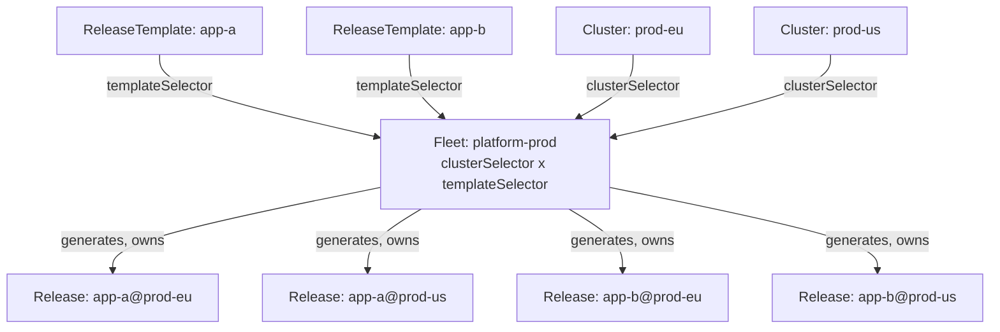

<!-- TOC -->
  * [Status](#status)
  * [Motivation](#motivation)
  * [Model](#model)
    * [How the kinds relate](#how-the-kinds-relate)
    * [Responsibility split](#responsibility-split)
  * [`ReleaseTemplate`](#releasetemplate)
  * [`Fleet`](#fleet)
    * [Selectors (the matrix)](#selectors-the-matrix)
    * [Policy defaults](#policy-defaults)
    * [Fleet-common mutations](#fleet-common-mutations)
    * [Conditional common mutations](#conditional-common-mutations)
    * [Rollout strategy](#rollout-strategy)
  * [Templating](#templating)
    * [Context](#context)
    * [Templatable surface](#templatable-surface)
  * [Generation semantics](#generation-semantics)
    * [Naming & ownership](#naming--ownership)
    * [Garbage collection on unmatch](#garbage-collection-on-unmatch)
    * [Mutation composition](#mutation-composition)
  * [Tenancy & access](#tenancy--access)
  * [Deferred / non-goals](#deferred--non-goals)
  * [Open questions](#open-questions)
<!-- TOC -->

## Status

**Proposed / design.** `ReleaseTemplate` and `Fleet` are not implemented yet. This document is the agreed design to build against; see the roadmap's *Redesign track*.

## Motivation

A `Release` targets exactly one `Cluster` with an immutable reference. That is deliberate and correct — but it means there is no useful way to *template* a single `Release`: with a fixed target, there is nothing to vary against. Per-cluster customization and fleet-wide rollout therefore do not belong on `Release`; they belong to a layer *above* it.

The realization that unifies three previously-separate ideas — **mutations**, **cluster-metadata templating**, and **fleet-wide orchestration** — is that they are the same *per-target-customization* substrate at different scopes:

- **templating** = per-cluster substitution, resolved at **generation time**;
- **mutations** = per-content transforms, applied at **render time** on a concrete `Release`;
- **fleet** = the **fan-out** that generates one customized `Release` per target.

So convoy adds two kinds that *generate* concrete `Release`s and leaves `Release` itself unchanged. The entire existing pipeline (fetch → render → values → prune → status → deletion finalizers) runs per generated `Release` as-is, and the deletion policy/finalizers and the `releaseByCluster` informer index are reused for cleanup.

## Model

- **`ReleaseTemplate`** — a reusable, single-app deployment definition: `source` + `content` (+ app-specific mutations, + optional policy overrides), carrying `{{ .cluster.* }}` placeholders and **no** cluster reference. One object per service, so a platform team's 30 services are 30 independently-owned, independently-diffable objects — not 30 specs inlined into one manifest.
- **`Fleet`** — *where* and *how*: a `clusterSelector` × `templateSelector` matrix, fleet-wide policy defaults, fleet-common mutations, and a rollout strategy. It generates a `Release` for every *(matching template × matching cluster)* pair.

Adding a service = create a labeled `ReleaseTemplate` (every matching `Fleet` picks it up — no `Fleet` edit). Adding a cluster = register a labeled `Cluster` (it automatically receives all the fleet's apps). `prod` vs `staging` = two `Fleet`s with different `clusterSelector`s reusing the same templates.

### How the kinds relate



### Responsibility split

| Concern                            | `ReleaseTemplate`                         | `Fleet`                                    | Generated `Release`                  |
|------------------------------------|-------------------------------------------|--------------------------------------------|--------------------------------------|
| `source`, `content`                | ✅ (with `{{ .cluster.* }}` placeholders) | —                                          | resolved                             |
| `clusterRef`                       | ✗ (comes from selection)                 | via `clusterSelector`                      | the matched cluster                  |
| which templates apply              | (carries labels)                          | via `templateSelector`                     | —                                    |
| sync / retention / deletion policy | optional **override**                     | **default**                                | `template ?? fleet`                  |
| mutations                          | app-specific (`spec.template.mutations`)  | fleet-common (org-wide / cluster-metadata) | `fleet-common ++ template`           |
| rollout strategy                   | —                                         | ✅                                         | — (rollout is a Fleet-level concern) |

Principle: **`Fleet` sets fleet-wide defaults; `ReleaseTemplate` may override per-app.** Templates stay lean in the common case (just `source` + `content`, inheriting everything) while an app that genuinely differs — e.g. a stateful service needing `keepWorkloads: true` — has an escape hatch without splitting fleets.

## `ReleaseTemplate`

A `ReleaseTemplate` embeds a whole `Release` under `spec.template`, mirroring the Kubernetes `PodTemplateSpec` pattern (`Deployment.spec.template`). The embedded template is a `Release` — `metadata` + `spec` + `mutations` + `lifecycle` — **minus `pin` and `spec.clusterRef`** (both come from elsewhere: `pin` is a runtime action, `clusterRef` from the fleet's cluster selection).

```yaml
apiVersion: core.convoy.kumodo.io/v1alpha1
kind: ReleaseTemplate
metadata:
  name: app-a                      # the template's own identity …
  namespace: platform
  labels:
    fleet-group: platform          # … matched by a Fleet's templateSelector
spec:
  template:
    metadata:                      # becomes the generated Release's metadata
      name: '{{ .cluster.name }}-{{ .self.name }}'   # .self = this ReleaseTemplate
      labels: {}
      annotations: {}
    spec:                          # same shape as Release.spec, minus clusterRef
      source:
        type: gitRepository
        gitRepository:
          name: app-a-repo
          ref: { tag: v1.4.2 }
      content:
        type: helm
        helm:
          path: charts/app-a
          ignoreMissingValuesFiles: true
          values:
            - type: gitRepository
              gitRepository:
                name: app-a-repo
                ref: { tag: v1.4.2 }
                paths: [ "envs/{{ .cluster.name }}/values.yaml" ]
      # optional per-app overrides of the Fleet policy defaults:
      # syncPolicy / retentionPolicy / deletionPolicy / healthAssessment
    mutations: []                  # optional app-specific post-render mutations
    lifecycle: {}                  # optional
```

**Two `metadata` blocks**, exactly like `Deployment`: `ReleaseTemplate.metadata` is the template's own identity (matched by the fleet's `templateSelector`); `spec.template.metadata` becomes the *generated Release's* metadata.

**Typing.** `spec.template.spec` reuses `Release`'s structs (so `kubectl explain` shows `clusterRef` as a field), but the validator **rejects** `clusterRef` if set — the generator injects it from the matched cluster. `spec.template` adds `mutations` and `lifecycle` alongside `spec` (their real position on a `Release`: siblings of `spec`, not under it). Policy blocks are optional — omitted means "inherit the Fleet default". String fields may contain templating (see [Templatable surface](#templatable-surface)).

## `Fleet`

```yaml
apiVersion: core.convoy.kumodo.io/v1alpha1
kind: Fleet
metadata:
  name: platform-prod
  namespace: platform
spec:
  clusterSelector:
    matchLabels: { env: prod }
  templateSelector:
    matchLabels: { fleet-group: platform }

  # fleet-wide policy defaults (each field of the generated Release
  # inherits these unless the ReleaseTemplate overrides it)
  syncPolicy: { automatic: true, interval: 5m, prune: { orphaned: true } }
  deletionPolicy: { keepWorkloads: false }
  retentionPolicy: { keepHistory: 10 }

  # applied to every generated Release, appended after the template's own mutations.
  # A commonMutation is a Release mutation (type + target + inline/from/patches)
  # plus one extra optional field, `if`.
  commonMutations:
    # no target -> applies to every rendered object; the body templates at render
    # time against {cluster,self,object}.
    - type: goTemplate
      inline:
        - |
          metadata:
            labels:
              convoy.kumodo.io/region: "{{ .cluster.region }}"
    # `if` is a CEL predicate evaluated at generation time (see "Conditional common
    # mutations"); when false, this mutation is omitted from that cluster's Release.
    - type: goTemplate
      if: cluster.region.startsWith('eu-')
      inline:
        - |
          metadata:
            annotations:
              example.com/data-residency: eu

  rollout:
    strategy: allAtOnce           # v1; staged/health-gated later
```

### Selectors (the matrix)

`clusterSelector` (over `Cluster` labels) × `templateSelector` (over `ReleaseTemplate` labels) → the generator produces one `Release` per pair. Both are `metav1.LabelSelector`. Matching on `cluster.spec.metadata` may be added later; label selection is the v1 mechanism.

Selector-based template inclusion is what removes the maintenance burden (no `Fleet` edit when the app set changes) — at the cost of a mislabeled template deploying fleet-wide. An explicit `templateRefs` list (safe, precise, but hand-maintained) may be offered as an alternative later; v1 uses the selector.

### Policy defaults

`syncPolicy`, `retentionPolicy`, and `deletionPolicy` on the `Fleet` are defaults. The generated `Release` uses `template.<policy> ?? fleet.<policy>` per block. This keeps policy uniform across the fleet by default while allowing per-app exceptions (notably `deletionPolicy.keepWorkloads` for stateful vs. stateless apps).

### Fleet-common mutations

`commonMutations` are applied to **every** generated `Release` — the headline fleet-wide customization (inject org labels/annotations, `imagePullSecrets`, or **cluster metadata**). They compose with the template's app-specific mutations (see [Mutation composition](#mutation-composition)).

A `commonMutation` is **identical to a `Release` mutation** (`type`, `target`, `inline`/`from`/`patches`) with exactly one addition: the optional [`if`](#conditional-common-mutations) field. On generation the `Fleet` evaluates `if`, drops it, and appends the remaining plain `ReleaseMutation` to the generated `Release` — so the mutation body itself is a normal `Release` mutation, templated at render time by the shared engine like any other.

### Conditional common mutations

A `commonMutation` may carry an optional **`if`** — a CEL predicate evaluated **at generation time**, per matched cluster. When it evaluates to false, the mutation is **omitted from that cluster's generated `Release`** entirely. So each generated `Release` ends up with exactly the common mutations that apply to *its* cluster, and its `.mutations` list stays an honest, diffable record of what was applied — the `Release` API and the render-time mutation engine never see a condition.

```yaml
commonMutations:
  - type: goTemplate
    if: cluster.region.startsWith('eu-')   # generation-time CEL, selects a cluster subset
    inline:
      - |
        metadata:
          annotations:
            example.com/data-residency: eu
```

**Why this exists.** The common per-environment split is already handled by `clusterSelector` + separate `Fleet`s, and per-cluster *values* by templating. `if` earns its keep only for a **heterogeneous fleet** where a mutation applies to a cluster *subset* not worth splitting into its own `Fleet` — e.g. a GPU toleration only where `cluster.gpu == 'true'`, a data-residency annotation only for EU regions, a compatibility shim gated on Kubernetes version. Expressing every such combination as separate fleets is a 2^N fleet explosion; `if` collapses it while keeping the core untouched.

**Design constraints.**

- **Generation-time only.** The predicate is evaluated when the `Fleet` materializes the `Release`, so its context is release-level: **`cluster`** and **`self`** (the same surface fleet templating exposes) — **not** `object`, which does not exist until render. Per-*object* scoping is a different axis and remains the mutation's `target` (GVK/name); `if` (which clusters) and `target` (which objects) are orthogonal.
- **CEL, not go-template.** `if` is a boolean predicate, and CEL yields a native bool (`cluster.region == 'eu-west'`); go-template would render the string `"true"`/`"false"`, which is awkward to consume. This mirrors the render-time split between `goTemplate` (text) and `celTransform` (logic).
- **Scope.** `if` is available on `commonMutations` only — not on policy blocks or template inclusion (that is the selector's job).
- **Zero blast radius.** `if` lives only on the `Fleet`'s `commonMutation` type (a `ReleaseMutation` + `if`); it is consumed and dropped at generation, so no field is added to `ReleaseMutation` and `internal/render` is untouched.

### Rollout strategy

`rollout.strategy` governs how the fleet sweeps across **clusters** — this is *cross-cluster* ordering, distinct from *in-cluster* canary/traffic-splitting (which remains an explicit non-goal, delegated to external tooling).

- **`allAtOnce`** (v1) — generate/update all matching `Release`s simultaneously.
- **staged / health-gated** (later) — roll out to cluster groups in waves, gating each wave on health. This depends on **health assessment** (the same primitive sync waves use, at fleet scope: waves order *resources* within a `Release`; fleet rollout orders *clusters* within a `Fleet`).

## Templating

Resolved once, at **generation time**, when the `Fleet` materializes each `Release`. The resulting `Release` contains only concrete values — no placeholders reach the reconcile path.

### Context

Generation-time templating exposes `{{ .cluster.* }}` and `{{ .self.* }}`:

| Field                                       | Source                                     |
|---------------------------------------------|--------------------------------------------|
| `.cluster.name`                             | the matched `Cluster`'s name               |
| `.cluster.<k>`                              | `Cluster.spec.metadata` keys, flattened    |
| `.self.name`, `.self.namespace`             | the `ReleaseTemplate`'s own metadata       |
| `.self.labels.<k>`, `.self.annotations.<k>` | the `ReleaseTemplate`'s labels/annotations |

`Cluster.spec.metadata` keys sit **directly** under `.cluster` (e.g. `.cluster.region`), not nested under `.metadata`; a metadata key literally named `name` is shadowed by the cluster name. The `.cluster` surface is identical to the render-time mutation context.

**`.self` is context-dependent** (self = the object carrying the expression): at **generation** time — resolving `spec.template.metadata.name`, values paths, etc., and evaluating a `commonMutation`'s `if` — `.self` is the **`ReleaseTemplate`**. At **render** time — inside a mutation body on the generated `Release` — `.self` is the **`Release`**. So `name: '{{ .cluster.name }}-{{ .self.name }}'` on a template named `app-a` yields `<cluster>-app-a`.

Engine: Go `text/template` (already a dependency via Helm) for value substitution; the conditional `if` on a `commonMutation` uses CEL over the same `cluster`/`self` context (see [Conditional common mutations](#conditional-common-mutations)).

### Templatable surface

Templating is applied to **specific string fields**, not the whole document (whole-doc string templating is fragile — a lesson from Argo ApplicationSet). Generation-time templatable fields: `spec.template.metadata.name` and `metadata.labels`/`metadata.annotations` values, and within `spec.template.spec` the values-file `paths`, inline value strings, and `content` path. The set is explicit and validated.

**Mutation bodies are *not* templated at generation.** A mutation — whether a `ReleaseTemplate`'s app-specific mutation or a fleet `commonMutation` — is copied onto the generated `Release` verbatim (a `commonMutation` only has its `if` evaluated and stripped) and is templated later at **render time** by the shared mutation engine, which exposes the same `cluster`/`self` context (plus `object`). So `{{ .cluster.region }}` inside a mutation body resolves at render, not generation.

A common pattern is a per-cluster values file (`envs/{{ .cluster.name }}/values.yaml`) that exists for some clusters and not others. Rather than a per-values-item `optional` flag, this is governed by a single helm-content-wide **`ignoreMissingValuesFiles`** boolean (mirroring Argo CD's `spec.source.helm.ignoreMissingValueFiles`): when set, a values source that resolves to a non-existent file/key is skipped instead of failing the render. It lives on the `helm` content block (a per-app concern), so a `ReleaseTemplate` opting in covers all its per-cluster overrides at once. Note this is a change from today's behavior, where a missing Git values path errors and `ConfigMap`/`Secret` sources use the selector's native `optional`; the flag consolidates that into one knob when implemented.

## Generation semantics

A `Fleet` controller lists `Cluster`s matching `clusterSelector` and `ReleaseTemplate`s matching `templateSelector`, and for each pair materializes a `Release` from `spec.template`: `metadata` = the template's `spec.template.metadata` with templating resolved; `clusterRef` = matched cluster (injected); `spec` = `spec.template.spec` with templating resolved, each policy block = `template.spec.<policy> ?? fleet.<policy>`; `mutations` = `fleet-common ++ template.mutations` (each `commonMutation` included only if its `if` passes for this cluster); `lifecycle` = `spec.template.lifecycle`. It reconciles on changes to the `Fleet`, any matching `Cluster` (incl. label changes), and any matching `ReleaseTemplate`.

### Naming & ownership

The generated `Release`'s name is the resolved `spec.template.metadata.name` with a short **identity-hash suffix** appended: `<resolved-name>-<hash>`, where the hash is over the **`(cluster name, template name)` identity** — *not* the template content. Hashing the identity (à la a Deployment's generated-name suffix, but over identity rather than pod-template content) guarantees uniqueness per pair — even if the resolved name omits cluster identity or two names collide — while keeping the name **stable across content edits**, so bumping a chart version or tweaking the template updates the same `Release` in place instead of renaming it (which would delete-and-recreate). The readable prefix is truncated as needed to stay DNS-safe; the hash always survives.

Each generated `Release` lives in the `Fleet`'s namespace, carries an `ownerReference` to the `Fleet`, and is labeled with the source template + cluster so ownership and provenance are explicit.

(Because the hash omits the `Fleet`, two `Fleet`s that both match the same template × cluster would generate the same name and collide — surfacing the misconfiguration as a name clash rather than silently double-managing one app on one cluster.)

### Garbage collection on unmatch

When a `Cluster` or `ReleaseTemplate` stops matching (relabeled or deleted), the corresponding generated `Release`(s) are deleted. Deletion runs the **`Release` deletion policy + finalizers** already implemented (prune vs. keep workloads, block-vs-give-up on unreachable), and the reverse "which Releases target this cluster" lookup uses the existing **`releaseByCluster` informer index**. Deleting the `Fleet` deletes all its generated `Release`s (each honoring its own deletion policy).

### Mutation composition

The generated `Release`'s mutation list is **`fleet.commonMutations` first, then the template's `spec.template.mutations` last** — so a `commonMutation` whose `if` is false is filtered out first, the surviving fleet-wide mutations form the baseline, and the app-specific template mutations apply **on top**. Since mutations apply in list order (a later one operating on an earlier one's output), the app-specific mutations therefore refine the fleet baseline. (Order is fixed rather than configurable to keep behavior predictable.)

This suits the v1 same-namespace model, where the platform team owns both the templates and the fleets. In the deferred **shared-template-library** case (template authors ≠ fleet authors), letting a template override a fleet-wide mutation may be undesirable — revisit ordering/enforcement then.

## Tenancy & access

v1 is **same-namespace**: a `Fleet`, its `ReleaseTemplate`s, the `Source`s they reference, and the `Cluster`s they target all live in one namespace — so tenancy = namespace and standard RBAC governs everything, with no `SubjectAccessReview` machinery. For a platform team that owns its clusters, sources, templates, and fleets, this is the natural fit and everything co-locates.

Two setups need more, and are deliberately deferred to an explicit **cross-namespace grant** model (an allow-list, e.g. on the `Cluster`: "Releases from namespaces X, Y may target me"):

- **central cluster registry** — one namespace owns all `Cluster`s; teams deploy from their own namespaces;
- **shared template library** — platform-owned `ReleaseTemplate`s referenced by many teams' fleets.

The grant model is additive, not a rework, so shipping same-namespace first does not paint us into a corner.

## Deferred / non-goals

- **Staged / health-gated rollout** — after health assessment lands; v1 is `allAtOnce`.
- **In-cluster progressive delivery** (canary/blue-green, traffic splitting) — non-goal; delegated to external tooling. Fleet rollout orders *clusters*, not pod traffic.
- **Generators beyond a cluster label selector** (matrix/list/git generators) — not planned; the cluster×template matrix covers the target use cases.
- **Explicit `templateRefs` list** — selector-only in v1; may be added if a fleet needs hand-picked membership.
- **Cross-namespace references / grants** — deferred with the authorization work.

## Open questions

- Should `ReleaseTemplate` policy override be per-block (`syncPolicy` as a whole) or per-field? Per-block is simpler; per-field is finer-grained.
- Cluster-metadata **matching** (not just label matching) in `clusterSelector` — needed, or do labels suffice?
- Scope of `ignoreMissingValuesFiles`: does it also govern absent `ConfigMap`/`Secret` values sources (superseding the selector's native `optional`), or only file-path sources? Leaning: it governs all values sources, for one consistent knob.
- Should `Fleet` provide a `healthAssessment` default (like `syncPolicy`/`retentionPolicy`/`deletionPolicy`), or is `healthAssessment` template-only? Its `globalRuleSetSelector` is plausibly fleet-wide while `deadline` is app-specific — so per-field defaulting may fit it better than per-block (relates to the first question).
