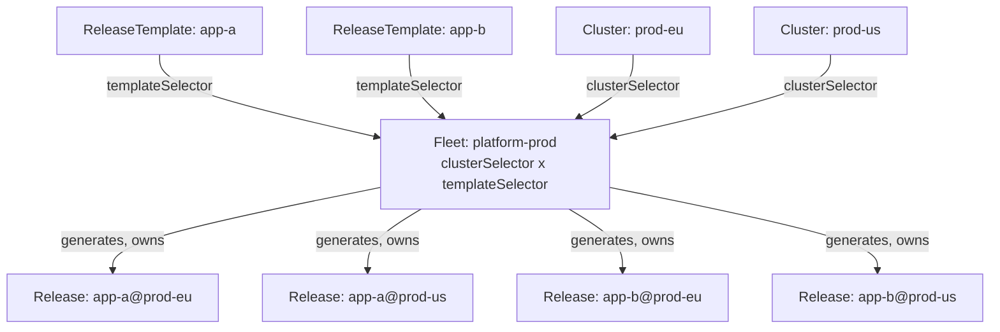

<!-- TOC -->
  * [Status](#status)
  * [Motivation](#motivation)
  * [Model](#model)
    * [How the kinds relate](#how-the-kinds-relate)
    * [Responsibility split](#responsibility-split)
  * [`ReleaseTemplate`](#releasetemplate)
  * [`Fleet`](#fleet)
    * [Selectors (the matrix)](#selectors-the-matrix)
    * [Policy defaults](#policy-defaults)
    * [Fleet-common mutations](#fleet-common-mutations)
    * [Rollout strategy](#rollout-strategy)
  * [Templating](#templating)
    * [Context](#context)
    * [Templatable surface](#templatable-surface)
  * [Generation semantics](#generation-semantics)
    * [Naming & ownership](#naming--ownership)
    * [Garbage collection on unmatch](#garbage-collection-on-unmatch)
    * [Mutation composition](#mutation-composition)
  * [Tenancy & access](#tenancy--access)
  * [Deferred / non-goals](#deferred--non-goals)
  * [Open questions](#open-questions)
<!-- TOC -->

## Status

**Proposed / design.** `ReleaseTemplate` and `Fleet` are not implemented yet. This document is the agreed design to build against; see the roadmap's *Redesign track*.

## Motivation

A `Release` targets exactly one `Cluster` with an immutable reference. That is deliberate and correct — but it means there is no useful way to *template* a single `Release`: with a fixed target, there is nothing to vary against. Per-cluster customization and fleet-wide rollout therefore do not belong on `Release`; they belong to a layer *above* it.

The realization that unifies three previously-separate ideas — **mutations**, **cluster-metadata templating**, and **fleet-wide orchestration** — is that they are the same *per-target-customization* substrate at different scopes:

- **templating** = per-cluster substitution, resolved at **generation time**;
- **mutations** = per-content transforms, applied at **render time** on a concrete `Release`;
- **fleet** = the **fan-out** that generates one customized `Release` per target.

So convoy adds two kinds that *generate* concrete `Release`s and leaves `Release` itself unchanged. The entire existing pipeline (fetch → render → values → prune → status → deletion finalizers) runs per generated `Release` as-is, and the deletion policy/finalizers and the `releaseByCluster` informer index are reused for cleanup.

## Model

- **`ReleaseTemplate`** — a reusable, single-app deployment definition: `source` + `content` (+ app-specific mutations, + optional policy overrides), carrying `{{ .Cluster.* }}` placeholders and **no** cluster reference. One object per service, so a platform team's 30 services are 30 independently-owned, independently-diffable objects — not 30 specs inlined into one manifest.
- **`Fleet`** — *where* and *how*: a `clusterSelector` × `templateSelector` matrix, fleet-wide policy defaults, fleet-common mutations, and a rollout strategy. It generates a `Release` for every *(matching template × matching cluster)* pair.

Adding a service = create a labeled `ReleaseTemplate` (every matching `Fleet` picks it up — no `Fleet` edit). Adding a cluster = register a labeled `Cluster` (it automatically receives all the fleet's apps). `prod` vs `staging` = two `Fleet`s with different `clusterSelector`s reusing the same templates.

### How the kinds relate



### Responsibility split

| Concern                            | `ReleaseTemplate`                        | `Fleet`                                    | Generated `Release`                  |
|------------------------------------|------------------------------------------|--------------------------------------------|--------------------------------------|
| `source`, `content`                | ✅ (with `{{ .Cluster.* }}` placeholders) | —                                          | resolved                             |
| `clusterRef`                       | ✗ (comes from selection)                 | via `clusterSelector`                      | the matched cluster                  |
| which templates apply              | (carries labels)                         | via `templateSelector`                     | —                                    |
| sync / retention / deletion policy | optional **override**                    | **default**                                | `template ?? fleet`                  |
| mutations                          | app-specific                             | fleet-common (org-wide / cluster-metadata) | `fleet-common ++ template`           |
| rollout strategy                   | —                                        | ✅                                          | — (rollout is a Fleet-level concern) |

Principle: **`Fleet` sets fleet-wide defaults; `ReleaseTemplate` may override per-app.** Templates stay lean in the common case (just `source` + `content`, inheriting everything) while an app that genuinely differs — e.g. a stateful service needing `keepWorkloads: true` — has an escape hatch without splitting fleets.

## `ReleaseTemplate`

A `Release` spec minus the cluster reference, plus templating placeholders.

```yaml
apiVersion: core.convoy.kumodo.io/v1alpha1
kind: ReleaseTemplate
metadata:
  name: app-a
  namespace: platform
  labels:
    fleet-group: platform        # matched by a Fleet's templateSelector
spec:
  source:                        # same shape as Release.spec.source
    type: gitRepository
    gitRepository:
      name: app-a-repo
      ref: { tag: v1.4.2 }
  content:
    type: helm
    helm:
      path: charts/app-a
      ignoreMissingValuesFiles: true   # per-cluster override files need not exist
      values:
        # per-cluster values file, resolved at generation time
        - type: gitRepository
          gitRepository:
            name: app-a-repo
            ref: { tag: v1.4.2 }
            paths: [ "envs/{{ .Cluster.name }}/values.yaml" ]
  # optional per-app overrides of the Fleet defaults:
  # syncPolicy / retentionPolicy / deletionPolicy
  # optional app-specific mutations
```

`spec` is deliberately the same shape as `Release.spec` (so the generator maps fields 1:1), with two differences: no `clusterRef`, and string fields may contain templating. Policy blocks are optional here — omitted means "inherit the Fleet default".

## `Fleet`

```yaml
apiVersion: core.convoy.kumodo.io/v1alpha1
kind: Fleet
metadata:
  name: platform-prod
  namespace: platform
spec:
  clusterSelector:
    matchLabels: { env: prod }
  templateSelector:
    matchLabels: { fleet-group: platform }

  # fleet-wide policy defaults (each field of the generated Release
  # inherits these unless the ReleaseTemplate overrides it)
  syncPolicy: { automatic: true, interval: 5m, prune: { orphaned: true } }
  deletionPolicy: { keepWorkloads: false }
  retentionPolicy: { keepHistory: 10 }

  # applied to every generated Release, before/after template mutations
  commonMutations:
    - type: strategicMergePatch
      # inject cluster metadata as labels across the whole fleet
      strategicMergePatch: |
        metadata:
          labels:
            convoy.kumodo.io/region: "{{ .Cluster.metadata.region }}"

  rollout:
    strategy: allAtOnce           # v1; staged/health-gated later
```

### Selectors (the matrix)

`clusterSelector` (over `Cluster` labels) × `templateSelector` (over `ReleaseTemplate` labels) → the generator produces one `Release` per pair. Both are `metav1.LabelSelector`. Matching on `cluster.spec.metadata` may be added later; label selection is the v1 mechanism.

Selector-based template inclusion is what removes the maintenance burden (no `Fleet` edit when the app set changes) — at the cost of a mislabeled template deploying fleet-wide. An explicit `templateRefs` list (safe, precise, but hand-maintained) may be offered as an alternative later; v1 uses the selector.

### Policy defaults

`syncPolicy`, `retentionPolicy`, and `deletionPolicy` on the `Fleet` are defaults. The generated `Release` uses `template.<policy> ?? fleet.<policy>` per block. This keeps policy uniform across the fleet by default while allowing per-app exceptions (notably `deletionPolicy.keepWorkloads` for stateful vs. stateless apps).

### Fleet-common mutations

`commonMutations` are applied to **every** generated `Release` — the headline fleet-wide customization (inject org labels/annotations, `imagePullSecrets`, or **cluster metadata**). They compose with the template's app-specific mutations (see [Mutation composition](#mutation-composition)).

### Rollout strategy

`rollout.strategy` governs how the fleet sweeps across **clusters** — this is *cross-cluster* ordering, distinct from *in-cluster* canary/traffic-splitting (which remains an explicit non-goal, delegated to external tooling).

- **`allAtOnce`** (v1) — generate/update all matching `Release`s simultaneously.
- **staged / health-gated** (later) — roll out to cluster groups in waves, gating each wave on health. This depends on **health assessment** (the same primitive sync waves use, at fleet scope: waves order *resources* within a `Release`; fleet rollout orders *clusters* within a `Fleet`).

## Templating

Resolved once, at **generation time**, when the `Fleet` materializes each `Release`. The resulting `Release` contains only concrete values — no placeholders reach the reconcile path.

### Context

Available under `{{ .Cluster.* }}`:

| Field                                 | Source                  |
|---------------------------------------|-------------------------|
| `.Cluster.name`, `.Cluster.namespace` | the matched `Cluster`   |
| `.Cluster.labels.<k>`                 | `Cluster` labels        |
| `.Cluster.metadata.<k>`               | `Cluster.spec.metadata` |

Engine: Go `text/template` (already a dependency via Helm).

### Templatable surface

Templating is applied to **specific string fields**, not the whole document (whole-doc string templating is fragile — a lesson from Argo ApplicationSet). Templatable fields: values-file `paths`, inline value strings, `content` path, mutation string arguments, and the generated `Release` name suffix. The set is explicit and validated.

A common pattern is a per-cluster values file (`envs/{{ .Cluster.name }}/values.yaml`) that exists for some clusters and not others. Rather than a per-values-item `optional` flag, this is governed by a single helm-content-wide **`ignoreMissingValuesFiles`** boolean (mirroring Argo CD's `spec.source.helm.ignoreMissingValueFiles`): when set, a values source that resolves to a non-existent file/key is skipped instead of failing the render. It lives on the `helm` content block (a per-app concern), so a `ReleaseTemplate` opting in covers all its per-cluster overrides at once. Note this is a change from today's behavior, where a missing Git values path errors and `ConfigMap`/`Secret` sources use the selector's native `optional`; the flag consolidates that into one knob when implemented.

## Generation semantics

A `Fleet` controller lists `Cluster`s matching `clusterSelector` and `ReleaseTemplate`s matching `templateSelector`, and for each pair materializes a `Release`: `clusterRef` = matched cluster; `source`/`content` = template with templating resolved; policy = `template ?? fleet`; mutations = `fleet-common ++ template`. It reconciles on changes to the `Fleet`, any matching `Cluster` (incl. label changes), and any matching `ReleaseTemplate`.

### Naming & ownership

Deterministic, DNS-safe name per pair (e.g. `<fleet>-<template>-<cluster>`), in the `Fleet`'s namespace. Each generated `Release` carries an `ownerReference` to the `Fleet` (and is labeled with the source template + cluster) so ownership and provenance are explicit.

### Garbage collection on unmatch

When a `Cluster` or `ReleaseTemplate` stops matching (relabeled or deleted), the corresponding generated `Release`(s) are deleted. Deletion runs the **`Release` deletion policy + finalizers** already implemented (prune vs. keep workloads, block-vs-give-up on unreachable), and the reverse "which Releases target this cluster" lookup uses the existing **`releaseByCluster` informer index**. Deleting the `Fleet` deletes all its generated `Release`s (each honoring its own deletion policy).

### Mutation composition

The generated `Release`'s mutation list is **`template` mutations first, then `fleet.commonMutations` last**, so fleet-wide/org policy has the final say over app-specific transforms. Both have templating resolved before materialization. (Order is fixed rather than configurable to keep behavior predictable.)

## Tenancy & access

v1 is **same-namespace**: a `Fleet`, its `ReleaseTemplate`s, the `Source`s they reference, and the `Cluster`s they target all live in one namespace — so tenancy = namespace and standard RBAC governs everything, with no `SubjectAccessReview` machinery. For a platform team that owns its clusters, sources, templates, and fleets, this is the natural fit and everything co-locates.

Two setups need more, and are deliberately deferred to an explicit **cross-namespace grant** model (an allow-list, e.g. on the `Cluster`: "Releases from namespaces X, Y may target me"):

- **central cluster registry** — one namespace owns all `Cluster`s; teams deploy from their own namespaces;
- **shared template library** — platform-owned `ReleaseTemplate`s referenced by many teams' fleets.

The grant model is additive, not a rework, so shipping same-namespace first does not paint us into a corner.

## Deferred / non-goals

- **Staged / health-gated rollout** — after health assessment lands; v1 is `allAtOnce`.
- **In-cluster progressive delivery** (canary/blue-green, traffic splitting) — non-goal; delegated to external tooling. Fleet rollout orders *clusters*, not pod traffic.
- **Generators beyond a cluster label selector** (matrix/list/git generators) — not planned; the cluster×template matrix covers the target use cases.
- **Explicit `templateRefs` list** — selector-only in v1; may be added if a fleet needs hand-picked membership.
- **Cross-namespace references / grants** — deferred with the authorization work.

## Open questions

- Should `ReleaseTemplate` policy override be per-block (`syncPolicy` as a whole) or per-field? Per-block is simpler; per-field is finer-grained.
- Cluster-metadata **matching** (not just label matching) in `clusterSelector` — needed, or do labels suffice?
- Scope of `ignoreMissingValuesFiles`: does it also govern absent `ConfigMap`/`Secret` values sources (superseding the selector's native `optional`), or only file-path sources? Leaning: it governs all values sources, for one consistent knob.
